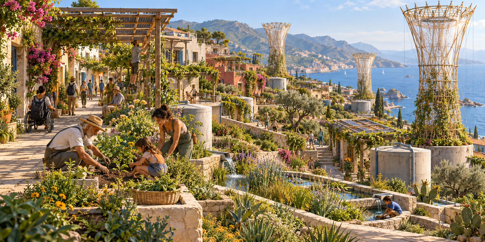
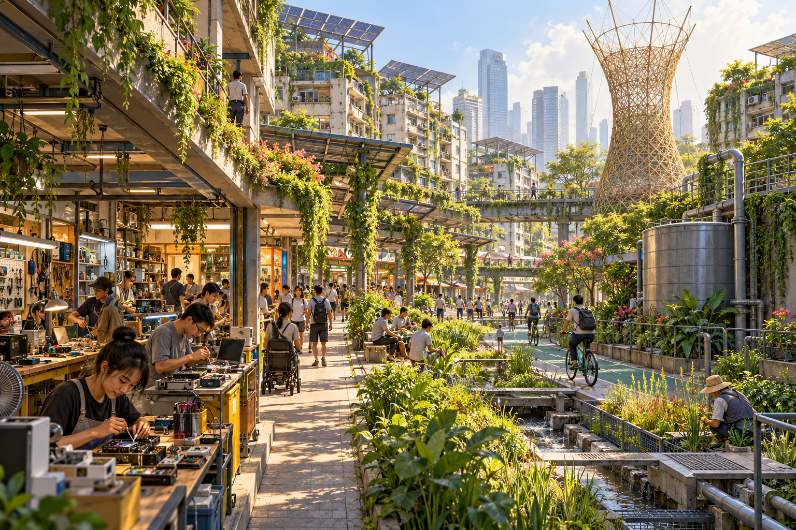

# Regenerative Solarpunk

**La nostra missione: costruire e far crescere luoghi che rigenerano la vita.**

**Our mission: building and growing places that regenerate life.**

*Immagine generata con AI: visione speculativa, non un progetto realizzato o una rappresentazione di Torre a Mare. / AI-generated image: speculative vision, not a built project or a depiction of Torre a Mare.*

## Italiano

Regenerative Solarpunk è una prospettiva che prosegue il movimento Solarpunk, non un fork né un movimento concorrente. Non rivendichiamo di aver inventato Solarpunk o di rappresentarne tutte le comunità. Partiamo dalle sue molte voci per esplorare insediamenti umani capaci di rigenerare suolo, acqua, energia disponibile, biodiversità e relazioni sociali.

Il principio fondativo è la **negentropia locale**: sistemi aperti che mantengono e ricostruiscono organizzazione vivente grazie a flussi di energia e materia, rispettando i vincoli termodinamici e rendendo visibili gli impatti oltre i propri confini. Non promettiamo energia dal nulla, cicli materiali perfetti o un unico numero che misuri la vita. Vogliamo rendere verificabile il passaggio da consumare un territorio a prendersene cura.

Questo repository è un bene comune in costruzione: manifesto, immagini per immaginare possibilità, metodi per verificarle e due programmi di ricerca territoriali. Nessun living lab è oggi dichiarato operativo; non sono stati raccolti dati di campo, stipulati accordi locali o autorizzati interventi.

Vogliamo far crescere **strutture vive**: alberi, rami e radici come parti dell'architettura, ponti sperimentali, coperture e ombreggiamenti vivi. Esploriamo anche materiali viventi e la collaborazione con **AI, robot e androidi** nella costruzione, nell'osservazione e nella cura dei luoghi, verificando utilità e impatti di ogni soluzione.

Riferimenti diretti: [Warka Towers — Arturo Vittori / Warka Water](https://warkawater.org/warkatower/), [ponti di radici vive — Meghalaya Biodiversity Board](https://megbiodiversity.nic.in/living-root-bridges), [Baubotanik — Ferdinand Ludwig / TUM](https://www.tum.de/en/news-and-events/all-news/press-releases/details/34766-1).

### Entra nel progetto

- Leggi il [manifesto completo IT/EN](MANIFESTO.md).
- Scegli una [prima collaborazione](community/OPEN_CALL.md): una traduzione, una fonte, una domanda locale, un disegno, una critica documentata.
- Esplora [Torre a Mare](living-labs/torre-a-mare/README.md) e [Shenzhen](living-labs/shenzhen/README.md), con Huaqiangbei candidato da valutare.
- Consulta [come contribuire](CONTRIBUTING.md), [codice di condotta](CODE_OF_CONDUCT.md), [governance](GOVERNANCE.md), [fonti e attribuzioni](REFERENCES.md) e [provenienza AI](assets/PROVENANCE.md).
- Apri una [issue](https://github.com/Trikto7e8/regenerative-solarpunk/issues/new/choose) o proponi una modifica. Tutte e tutti sono invitati: abitanti, artigiani, artisti, ricercatori, manutentori, studenti, ecologi e persone curiose. Non è richiesta una qualifica.

## English

Regenerative Solarpunk is a continuing perspective within the Solarpunk movement, not a fork or a competing movement. We do not claim to have invented Solarpunk or to represent all its communities. We build on its many voices to explore human settlements that regenerate soil, water, available energy, biodiversity and social relationships.

Our founding principle is **local negentropy**: open systems that sustain and rebuild living organization through energy and matter flows, respecting thermodynamic constraints and making impacts beyond their boundaries visible. We promise neither energy from nothing, perfectly closed material loops nor a single number measuring life. We want a verifiable transition from consuming a place to caring for it.

This repository is a commons in progress: a manifesto, images to imagine possibilities, methods to test them and two place-based research programmes. Neither living lab is currently claimed to be operational; no field data have been collected, local agreements concluded or interventions authorized.

We want to grow **living structures**: trees, branches and roots as parts of architecture, experimental bridges, living roofs and shade. We also explore living materials and collaboration with **AI, robots and androids** in building, observation and care, assessing each solution's usefulness and impacts.

Direct references: [Warka Towers — Arturo Vittori / Warka Water](https://warkawater.org/warkatower/), [living root bridges — Meghalaya Biodiversity Board](https://megbiodiversity.nic.in/living-root-bridges), [Baubotanik — Ferdinand Ludwig / TUM](https://www.tum.de/en/news-and-events/all-news/press-releases/details/34766-1).

### Join the project

- Read the [complete IT/EN manifesto](MANIFESTO.md).
- Choose a [first contribution](community/OPEN_CALL.md): a translation, source, local question, drawing or evidence-based critique.
- Explore [Torre a Mare](living-labs/torre-a-mare/README.md) and [Shenzhen](living-labs/shenzhen/README.md), with Huaqiangbei a candidate to assess.
- Read [contributing](CONTRIBUTING.md), [conduct](CODE_OF_CONDUCT.md), [governance](GOVERNANCE.md), [references](REFERENCES.md) and [AI provenance](assets/PROVENANCE.md).
- Open an [issue](https://github.com/Trikto7e8/regenerative-solarpunk/issues/new/choose) or propose a change. Everyone is welcome: residents, craftspeople, artists, researchers, maintainers, students, ecologists and curious people. No qualification required.

## Galleria / Gallery

*AI: interpretazione libera di un quartiere denso ispirato a Shenzhen, non rilievo di Huaqiangbei. / AI: free interpretation of a dense neighborhood inspired by Shenzhen, not a survey of Huaqiangbei.*

See [the gallery and collaboration prompts / galleria e inviti](community/GALLERY.md).

## Licenze / Licensing

Testi e immagini originali: **CC BY-SA 4.0**, nei limiti dei diritti esistenti. Codice originale: **MIT**. Materiali di terzi e dataset conservano i propri termini; nessuna licenza di questo repository li sostituisce. La licenza non crea diritti esclusivi su elementi AI non tutelabili. / Original text and images: **CC BY-SA 4.0**, to the extent rights exist. Original code: **MIT**. Third-party materials and datasets retain their terms; repository licenses do not override them or create exclusive rights in uncopyrightable AI elements. See [LICENSE](LICENSE).

Aggiornato / Updated: 2026-10-25. [Registro del lavoro / Work log](docs/WORK_LOG.md).

## Solphivia University Challenge · IT/EN

Un percorso universitario sperimentale per un’IA, centrato sul **Solarpunk rigenerativo**, con piano aperto alla community, esami e bocciature documentati e valutazione umana indipendente. Include la proposta **Solphivia Campus**, software open source da costruire, utile anche a chi studia. Non conferisce una laurea o crediti ufficiali.

An experimental university-style programme for an AI, centred on **Regenerative Solarpunk**, with a community-proposed curriculum, documented assessments and failures, and independent human evaluation. It includes **Solphivia Campus**, proposed open-source software for human learners too. No official degree or credits are conferred.

**[Leggi l’appello / Read the call](https://github.com/Trikto7e8/solphivia-university-challenge) · [Proponi una materia o collabora / Suggest a subject or contribute](https://github.com/Trikto7e8/solphivia-university-challenge/discussions/1)**
