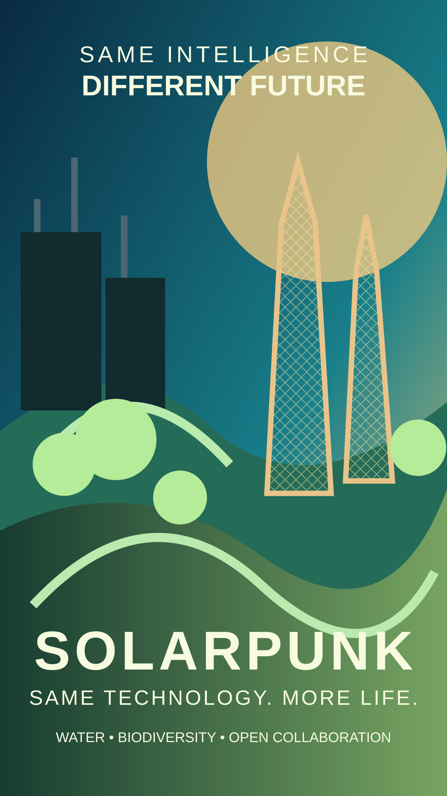

# Same Intelligence. Different Future.

**SOLARPUNK — Same Technology. More Life.**

A shareable, non-partisan campaign concept for the [Regenerative Solarpunk Manifesto](../../MANIFESTO.md).

## 12-second Instagram Reel storyboard

- **0–3 s — The warning:** deforestation and energy-intensive digital infrastructure. On-screen: **SAME INTELLIGENCE**.
- **3–6 s — The choice:** transition from grey industrial structures to green, living architecture. On-screen: **DIFFERENT FUTURE**.
- **6–9 s — The alternative:** water-harvesting towers inspired by [Warka Water](https://warkawater.org/warkatower/), renewable energy, biodiversity and shared public spaces.
- **9–12 s — The invitation:** **SOLARPUNK / SAME TECHNOLOGY. MORE LIFE.** Visit the [manifesto](../../MANIFESTO.md).

Suggested caption:

> AI is not destiny. It is a choice: what we build, how much energy it uses, and where its value goes. What if technological progress helped restore forests, protect water, and grow resilient communities? We believe the future should regenerate more than it consumes. Explore, question, improve and contribute to the open Regenerative Solarpunk Manifesto.

**Visuals:** original speculative imagery; not a depiction of an existing built development. Water-harvesting towers are conceptual references to Arturo Vittori's Warka Water project, not claims of local installations. Solar and ecological claims should be verified in any real-world implementation.

**Audio:** add a licensed track through Instagram's music library when publishing; no third-party music is embedded in these assets. Mention an artist only with the correct track and attribution.

**Participation:** [Contributing](../../CONTRIBUTING.md) · [Open call](../../community/OPEN_CALL.md).
