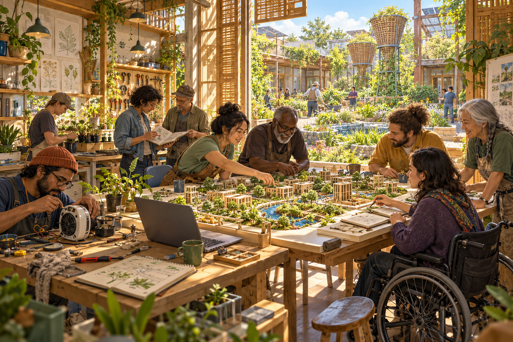
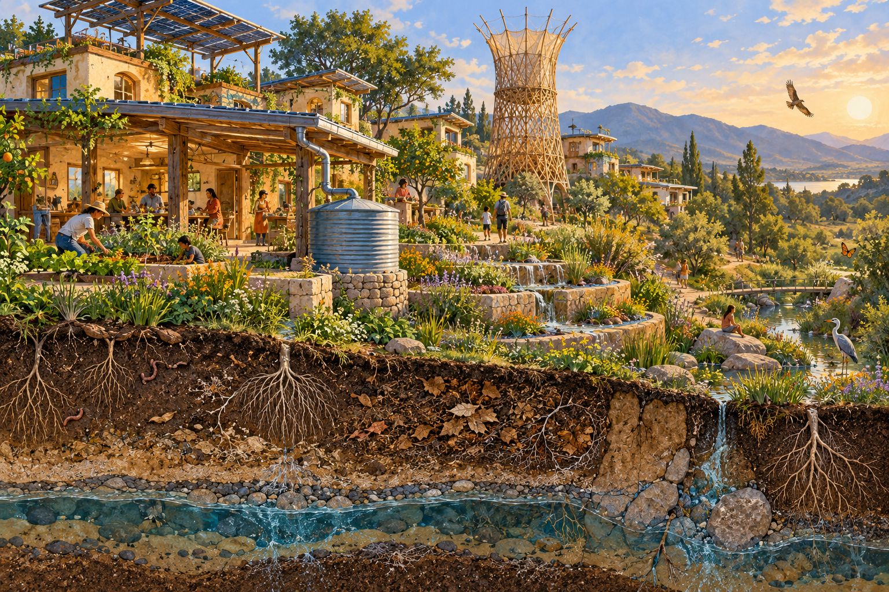

# Immaginare per collaborare / Imagine to collaborate

**Tutte le immagini sono generate con AI. Visioni speculative, non fotografie, rilievi, progetti approvati o prove di prestazioni. Le persone sono sintetiche. / All images are AI-generated speculative visions, not photographs, surveys, approved plans or performance evidence. People are synthetic.**

## 1 · Abitare l'acqua / Inhabiting water

IT: Un luogo quotidiano in cui acqua, ombra e cura del suolo diventano parte dell'abitare. Le torri si ispirano al lavoro di Arturo Vittori/Warka Water. Non è Torre a Mare: morfologia, colture e abbondanza d'acqua sono immaginative. **Aiutaci a confrontare raccolta dai tetti, risparmio idrico e raccolta atmosferica in un contesto reale.**

EN: An ordinary place where water, shade and soil care become part of inhabitation. The towers are inspired by Arturo Vittori/Warka Water. This is not Torre a Mare: terrain, plants and water abundance are imaginative. **Help compare roof capture, water savings and atmospheric collection in a real context.**

## 2 · La città che ripara / The city that repairs

IT: Una visione ispirata al rapporto tra elettronica e vita urbana di Shenzhen. Non è un rilievo di Huaqiangbei. **Cerchiamo interlocutori locali per scegliere il quartiere e capire quali pratiche di riparazione riducono davvero gli impatti.**

EN: A vision inspired by the relationship between electronics and urban life in Shenzhen. It is not a survey of Huaqiangbei. **We seek local collaborators to select the neighborhood and understand which repair practices actually reduce impacts.**

## 3 · Il futuro si costruisce al tavolo / The future is made around a table

IT: Prima delle infrastrutture, persone che ascoltano, discutono, disegnano e si passano competenze. L'AI può essere uno strumento sul tavolo; le decisioni restano umane. **Porta una tecnica, una traduzione, una domanda o una critica: iniziamo da un contributo piccolo e utile.**

EN: Before infrastructure, people listen, discuss, draw and share skills. AI can be a tool on the table; decisions remain human. **Bring a technique, translation, question or critique: begin with one small useful contribution.**

## 4 · Sotto la città, la vita / Beneath the settlement, life

IT: Una sezione evocativa per ricordare le relazioni che le facciate nascondono: radici, suolo, acqua, materiali e manutenzione. Non è un diagramma scientifico e non mostra un ciclo chiuso. **Aiutaci a trasformare questa visione in domande misurabili e a individuare ciò che manca.**

EN: An evocative cutaway recalling relationships hidden by façades: roots, soil, water, materials and maintenance. It is not a scientific diagram or a closed cycle. **Help turn the vision into measurable questions and identify what is missing.**

Attribution / Attribuzione: Regenerative Solarpunk contributors; AI generation with OpenAI image generation, 2026-10-25. CC BY-SA 4.0 to the extent rights exist. [Prompts and provenance / Prompt e provenienza](../assets/PROVENANCE.md). Warka Water inspiration does not imply endorsement or a license to its designs.
